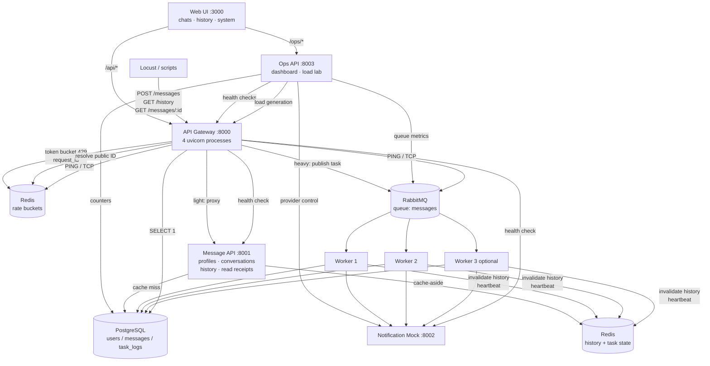
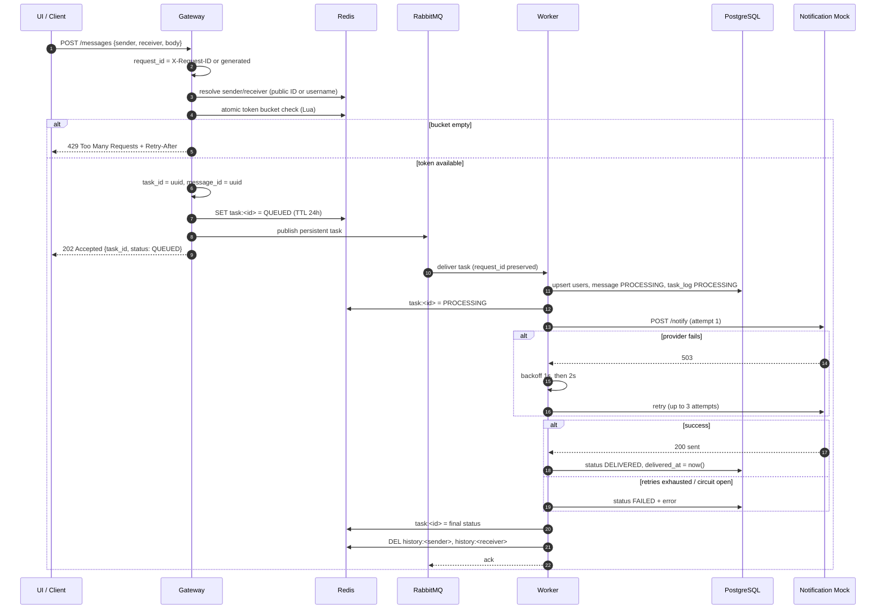
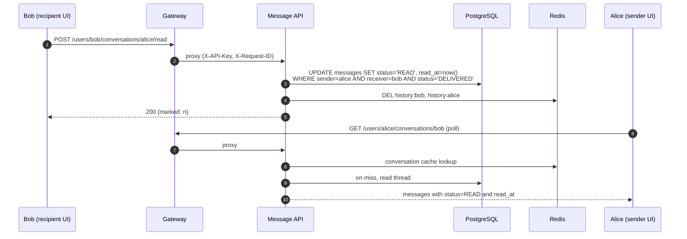
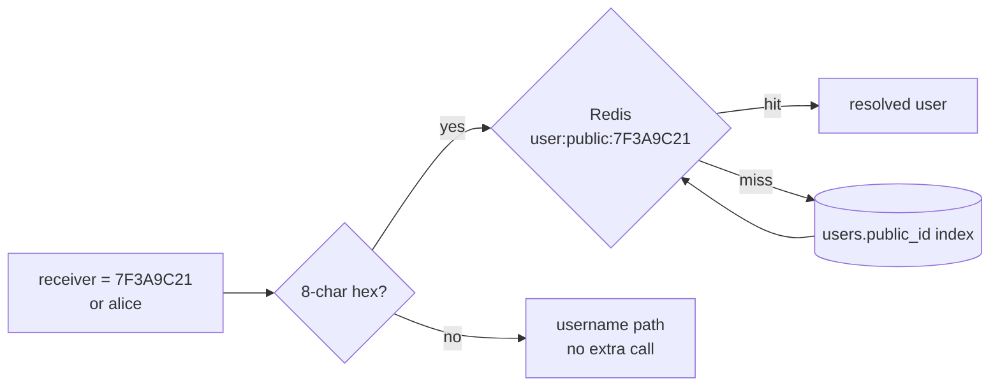
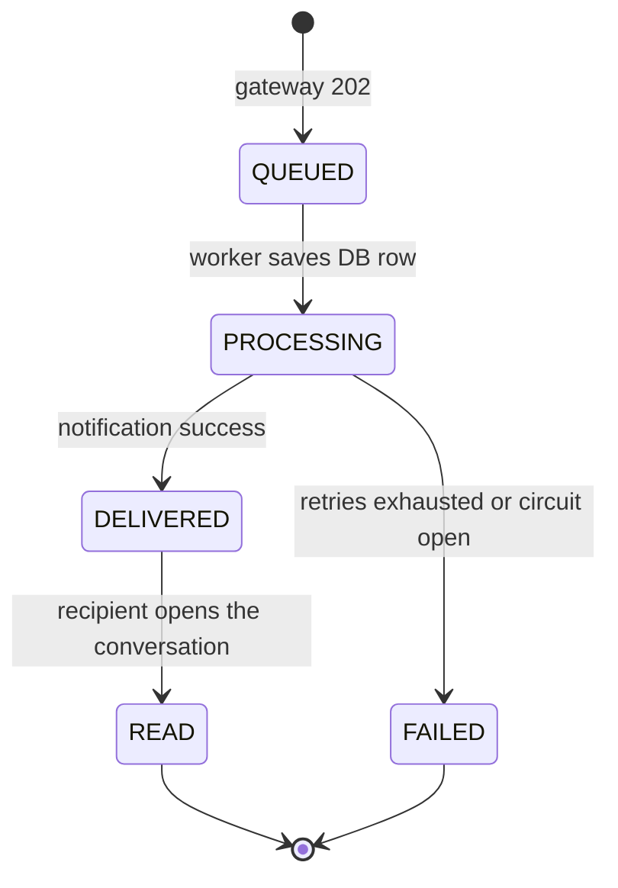
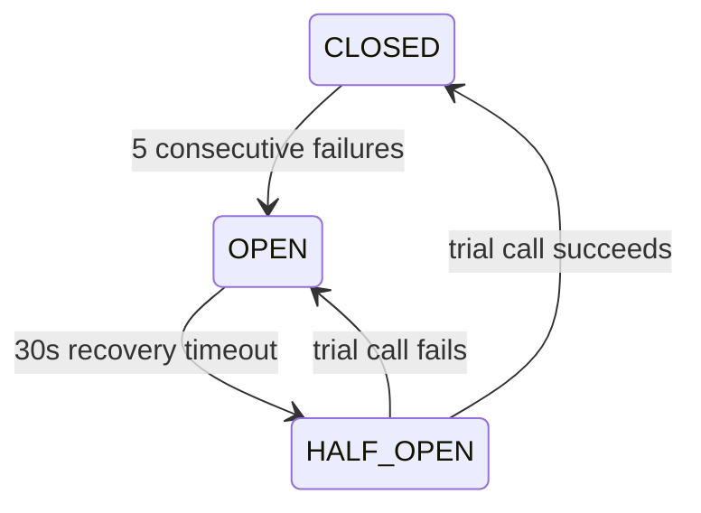
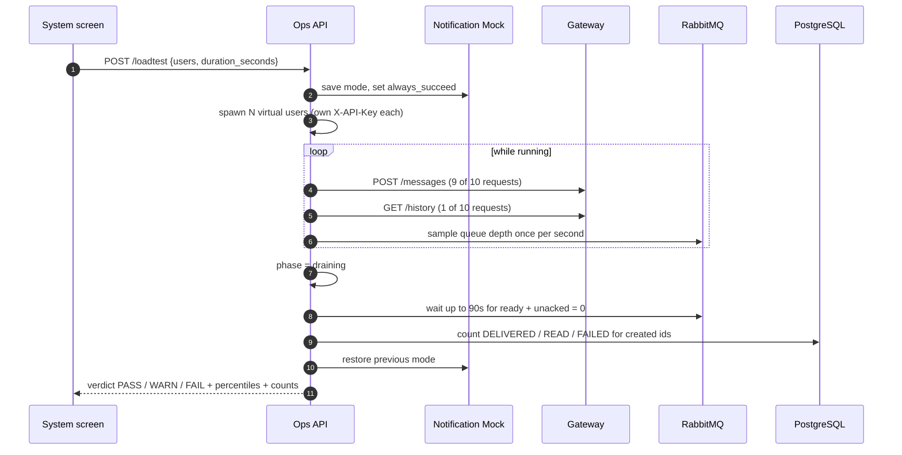

# PingHub Architecture and Data Flow

PingHub has two faces on the same backend:

- an **end-user web app** (`ui`, port 3000) for chatting, history, and read
  receipts;
- the original **HTTP API** (gateway, port 8000) used by scripts and Locust.

Both go through the same gateway, RabbitMQ queue, worker pool, PostgreSQL and
Redis. An **ops API** (port 8003) reads metrics and runs the in-app Load Lab.

## 1. Component diagram



The UI is served by nginx, which proxies `/api/` to the gateway and `/ops/` to
the ops API. That gives the browser a single origin and removes CORS from the
picture entirely.

## 2. Heavy request: `POST /messages`



`202` is returned before any database write. The queue, not the HTTP handler,
absorbs the slow part.

## 3. Read receipt flow

A read receipt is a product-level state change, not another delivery attempt.
It is created when the recipient opens the conversation while the tab is
visible.



The sender's UI polls every ~2.6 seconds, so the tick changes from a single
check to a blue double check with the read time. No WebSocket is required.

## 4. Public ID resolution



- `users.public_id` is 8 uppercase hex characters, generated by the database
  default, unique and indexed.
- Lookups accept a public ID, a username, or a UUID.
- The gateway caches public-ID resolution in Redis, so a normal username send
  costs nothing extra.
- An unknown public ID returns `404` instead of being silently treated as a new
  username.

## 5. Conversation and history reads

`GET /users/{me}/conversations` returns one row per peer with the last message
and an **unread count** (`receiver=me AND status='DELIVERED'`).
`GET /users/{me}/conversations/{peer}` returns the full thread and is what the
chat screen renders.

`GET /history?user=alice` keeps the original cache-aside behaviour:


`user` may be a username or a public ID. The UI renders `X-Cache` as the
**redis cache: HIT/MISS** badge.

## 6. Message status state machine



`READ` counts as delivered. The worker's idempotency check treats an existing
`DELIVERED` **or** `READ` row as done, so a RabbitMQ redelivery never resends a
notification or downgrades the status.

## 7. Circuit breaker state machine



## 8. In-app Load Lab

The Load Lab lives in `ops-api` so an expensive test cannot compete with real
message traffic.



Verdict rules:

| Verdict | Condition |
|---|---|
| **PASS** | 0 server/network errors, every accepted message terminal, queue drained |
| **WARN** | queue did not drain in 90s, or messages still `QUEUED`/`PROCESSING`, or accounting mismatch |
| **FAIL** | any `5xx` or unstructured network failure |

`429` is excluded from the failure count: it is the rate limiter doing its job,
and it is reported separately.

## 9. Failure and recovery behaviour

| Failure | Behaviour |
|---|---|
| Client sends too fast | Gateway returns 429; bucket refills at 1 token/s |
| Redis unavailable | Rate limiter falls back to in-process memory; public-ID cache and history reads skip cache; `/health` reports Redis down |
| RabbitMQ unavailable | Gateway returns 503 for `POST /messages`; reads still work |
| Worker crash before ack | RabbitMQ redelivers; worker is idempotent (`ON CONFLICT`, `READ`/`DELIVERED` short-circuit) |
| Notification provider flaky | Up to 3 attempts with 1s then 2s backoff |
| Notification provider down | Circuit opens after 5 failures; tasks fail fast; HALF_OPEN probes after 30s |
| Database unavailable | Worker requeues the task; gateway `/health` reports PostgreSQL down |
| Unknown public ID | Gateway returns 404 without publishing a task |
| `message-api` down | Gateway reports it in `/health`; sends still queue, but chats/history return 503 |
| `ops-api` down | Chat and history are unaffected; only the System screen and Load Lab break |
| Browser tab closed mid-chat | No data loss: state lives in PostgreSQL; reopening the thread reloads it |
| Duplicate read request | `UPDATE ... WHERE status='DELIVERED'` is idempotent; second call marks 0 rows |

## 10. Logging and traceability

The gateway creates `request_id` and returns it as `X-Request-ID`. It is placed
in the RabbitMQ task payload, so the worker logs the same id. A single request
can therefore be followed through:

```text
gateway → cache → queue → worker → database
```

Example:

```json
{"service":"gateway","request_id":"r-101","event":"accepted","tokens_left":7}
{"service":"gateway","request_id":"r-101","event":"queued","task_id":"t-55"}
{"service":"worker","request_id":"r-101","event":"db_saved","status":"PROCESSING"}
{"service":"worker","request_id":"r-101","event":"notify_failed","attempt":1}
{"service":"worker","request_id":"r-101","event":"notify_ok","attempt":2}
{"service":"worker","request_id":"r-101","event":"db_updated","status":"DELIVERED"}
```

Read receipts and ops calls carry the same header, so `docker compose logs`
can trace UI actions as well.

## 11. Why these choices?

| Decision | Reason |
|---|---|
| FastAPI | Async I/O fits a gateway and queue worker; automatic OpenAPI docs |
| RabbitMQ | Durable queue, acknowledgements, redelivery, management UI |
| PostgreSQL | Strong consistency for message/task state and history queries |
| Redis | Sub-millisecond cache, atomic Lua token bucket, shared across replicas, public-ID cache |
| Separate message-api | Keeps read traffic away from the write path; independently scalable |
| Separate ops-api | Dashboard aggregation and load generation cannot slow down the message path |
| Static UI served by nginx | No build step, no CORS, one origin for `/api/` and `/ops/` |
| Public IDs | Short enough to share verbally; indexed; UUIDs remain supported internally |
| `READ` status + timestamps | Gives the sender a real receipt and preserves when delivery/read happened |
| Polling instead of WebSockets | Read paths are cheap and cached; simpler and survives reloads/proxies |
| Two worker replicas | Shows horizontal scaling and survives one worker dying |
| Four gateway processes | Uses multiple CPU cores while Redis keeps the limiter globally consistent |
| Concurrent worker tasks | Prefetch bounds in-flight work; a retry sleep cannot stall the whole consumer |
| Short `/health` cache | Monitoring can poll without opening a database connection per check |
