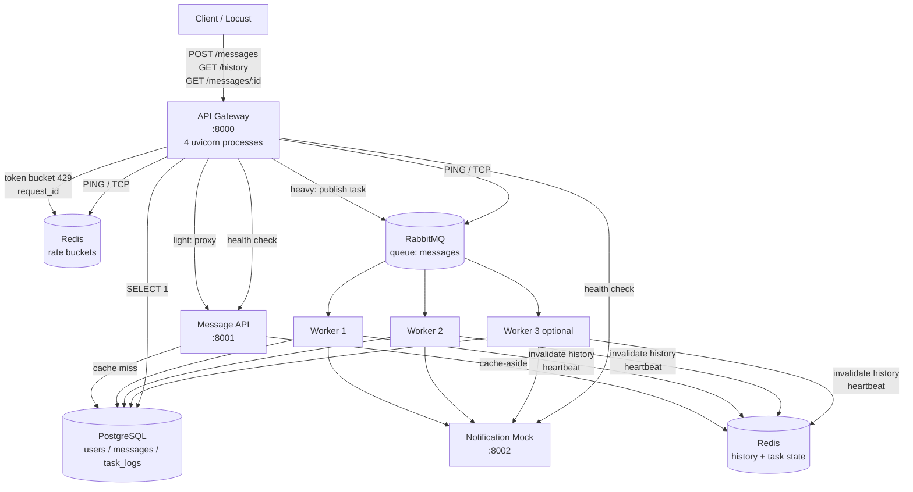
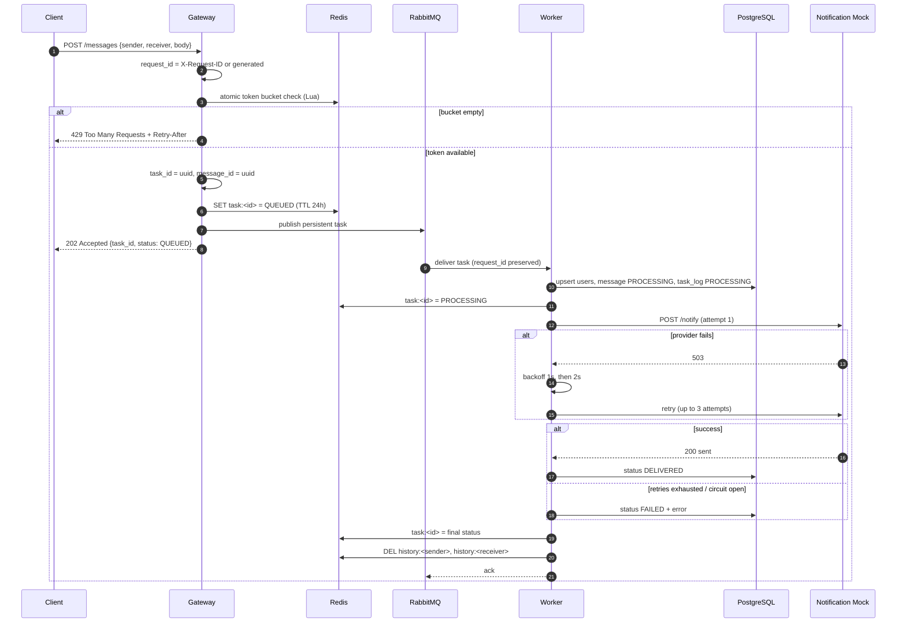
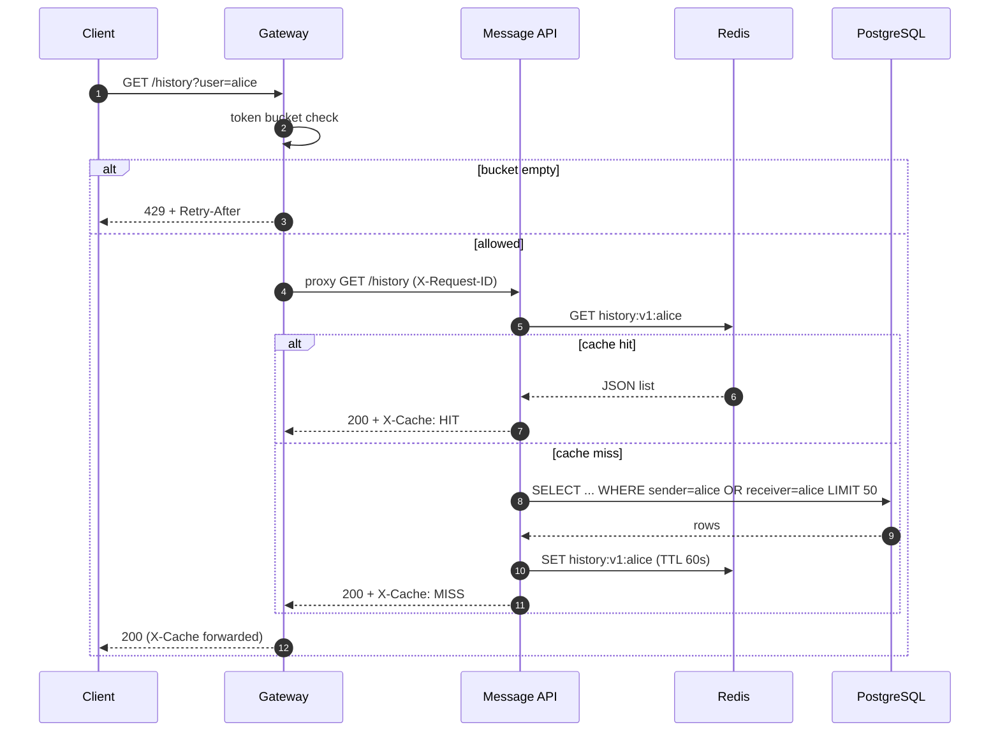
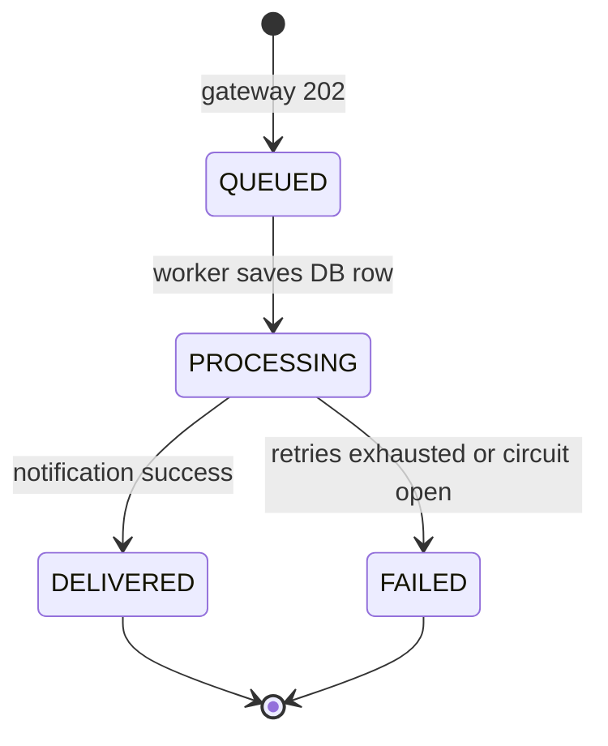
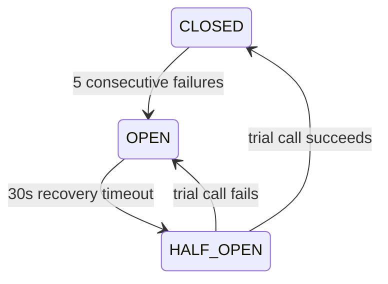

# PingHub Architecture and Data Flow

## 1. Component diagram



## 2. Heavy request: `POST /messages`



## 3. Light request: `GET /history?user=alice`



## 4. Message status state machine



## 5. Circuit breaker state machine



## 6. Failure and recovery behaviour

| Failure | Behaviour |
|---|---|
| Client sends too fast | Gateway returns 429; bucket refills at 1 token/s |
| Redis unavailable | Rate limiter falls back to in-process memory; history reads skip cache; `/health` reports Redis down |
| RabbitMQ unavailable | Gateway returns 503 for `POST /messages`; reads still work |
| Worker crash before ack | RabbitMQ redelivers; worker is idempotent (`ON CONFLICT`) |
| Notification provider flaky | Up to 3 attempts with 1s then 2s backoff |
| Notification provider down | Circuit opens after 5 failures; tasks fail fast; HALF_OPEN probes after 30s |
| Database unavailable | Worker requeues the task; gateway `/health` reports PostgreSQL down |

## 7. Logging and traceability

The gateway creates `request_id` and returns it as `X-Request-ID`. It is placed
in the RabbitMQ task payload, so the worker logs the same id. A single request
can therefore be followed through:

```text
gateway → cache → queue → worker → database
```

Example:

```json
{"service":"gateway","request_id":"r-101","event":"accepted","tokens_left":7}
{"service":"gateway","request_id":"r-101","event":"queued","task_id":"t-55"}
{"service":"worker","request_id":"r-101","event":"db_saved","status":"PROCESSING"}
{"service":"worker","request_id":"r-101","event":"notify_failed","attempt":1}
{"service":"worker","request_id":"r-101","event":"notify_ok","attempt":2}
{"service":"worker","request_id":"r-101","event":"db_updated","status":"DELIVERED"}
```

## 8. Why these choices?

| Decision | Reason |
|---|---|
| FastAPI | Async I/O fits a gateway and queue worker; automatic OpenAPI docs |
| RabbitMQ | Durable queue, acknowledgements, redelivery, management UI |
| PostgreSQL | Strong consistency for message/task state and history queries |
| Redis | Sub-millisecond cache, atomic Lua token bucket, shared across replicas |
| Separate message-api | Keeps read traffic away from the write path; independently scalable |
| Two worker replicas | Shows horizontal scaling and survives one worker dying |
| Four gateway processes | Uses multiple CPU cores while Redis keeps the limiter globally consistent |
| Concurrent worker tasks | Prefetch bounds in-flight work; a retry sleep cannot stall the whole consumer |
| Short `/health` cache | Monitoring can poll without opening a database connection per check |
